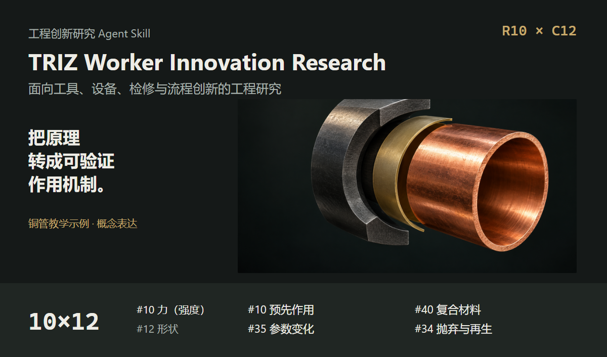

# TRIZ Worker Innovation Research

**面向工具、设备、检修与作业流程创新的工程研究 Agent Skill**

[English](README_EN.md) · [快速开始](#一分钟开始) · [教学示例](#从一段现场描述到可检查的研究) · [工作流](#研究如何推进) · [贡献](CONTRIBUTING.md)

[](https://github.com/luchi2333/triz-worker-innovation-research/releases)
[](https://github.com/luchi2333/triz-worker-innovation-research/actions/workflows/validate.yml)
[](LICENSE)

把现场问题转成可追溯、可反证、可验证的工程研究：先还原工序、系统边界与硬约束，再做 TRIZ 分析、确定性矩阵查询和技术查新，最后形成候选方案、FMEA、决定性试验与技术报告。



## 从一段现场描述到可检查的研究

下面是一个**完全虚构的薄壁铜管教学示例**，用来说明研究链如何展开。完整过程见 [examples/thin-wall-tube-clamping.md](examples/thin-wall-tube-clamping.md)。

> 某教学车间用台虎钳夹持薄壁铜管锯切，管子容易失圆。希望夹持更稳，但不能增加管壁变形。

Skill 先把描述整理成问题模型，用 `F/M/S/H` 分开不同证据状态：

| 标记 | 含义 | 本例中的用法 |
|---|---|---|
| `F` | 现场报告事实 | 操作对象、工序和「夹持后容易失圆」的报告 |
| `M` | 受控实测 | 管径、壁厚、夹紧力和报废率；未知项保留待测 |
| `S` | 可追溯外部来源 | 后续真实检索获得的标准、产品、专利与论文 |
| `H` | 工程假设 / 推导 | 接触压力分布不均等待验证的解释与候选机制 |

主矛盾映射为欲改善 **#10 力（强度）**，随之恶化 **#12 形状**，固定查询方向为 **10×12**。内置经典矩阵依次返回：

1. **#10 预先作用**：研究预装可拆衬块；
2. **#35 参数变化**：研究钳口曲率、接触长度与表层硬度；
3. **#40 复合材料**：研究硬质支承与柔性表层的组合；
4. **#34 抛弃与再生**：研究可更换的磨损表层。

这些原理随后进入来源核验、路线比较、风险分析和决定性试验，而不是直接成为定型方案。教学示例不含真实企业、型号、项目数据、外部检索结果或实测效果。

## 一分钟开始

把下面一句话复制给 Codex：

```text
请使用 skill-installer 从以下地址安装技能，安装后告诉我如何开始：
https://github.com/luchi2333/triz-worker-innovation-research/tree/main/triz-worker-innovation-research
```

安装后直接描述问题：

```text
请使用 $triz-worker-innovation-research 研究这个职工创新问题：
目前……；主要困难……；希望改善……；不能牺牲……。
```

无需先懂 TRIZ，也无需另装矩阵或 Deep Research Skill。实时产品、专利、标准和论文研究仍依赖宿主 Agent 自身具备联网检索能力。

首次完整 TRIZ 分析后，Skill 在 `G1.5` 暂停并核对研究方向。你可以修正事实与边界，保留、暂停或新增方向；已有明确委托时记录原话与范围后继续，沉默不算确认。

## 研究如何推进

```text
G0 问题锚定 → G1 系统与 TRIZ 建模 → G1.5 用户方向确认 → G2 深度研究
            → G3 候选方案 → G4 验证 / 安全 / 效益 → G5 正式报告
```

| 阶段 | 你会看到什么 |
|---|---|
| 问题与矛盾 | 原始型号与术语、完整工序、系统边界、硬约束和 `F/M/S/H` 问题模型 |
| 确定性分析 | 39 个工程参数、40 条发明原理和经典 39×39 矩阵；Python、Node 与可读行分片三种查询路径 |
| 深度研究 | 产品、专利、标准、论文、原厂资料、跨行业类比与反对证据，以及可复现检索日志 |
| 候选决策 | 成熟基准、工程后备、探索路线和超系统替代，写清作用链、来源、风险与退出条件 |
| 验证与效益 | FMEA、样本与指标、验收 / 停止条件、V0–V3 成熟度，以及可复算的经济效益与社会效益模型 |
| 正式交付 | 决策摘要、工程图、主报告、技术证据附件、研究台账、DOCX 与交付清单 |

关键事实集中维护在 `research-record.json`，摘要、正文、参数、计算和图示从同一事实源取值。G5 先规划图组，再按机械、电气 / 测量、控制 / 软件、热 / 流体或工艺 / 作业选择相应表达；结构、计算一致性与工程复核分别报告。

## 为什么不直接让 AI 脑暴？

普通问答容易从现场描述跳到方案，省略系统边界、矩阵来源、适配核验和验证条件。本 Skill 把这些环节放进同一条研究链：

| 普通 TRIZ Prompt / 查询器 | 本 Skill |
|---|---|
| 给出若干发明原理或点子 | 先还原工序、根因、系统边界和约束 |
| 可能凭模型记忆回答矩阵 | 内置 JSON、Python、Node 和 39 个行分片，结果可复算 |
| 搜到资料即作为结论 | 记录检索式，核验来源身份、适配性与反对证据 |
| 输出单一方案 | 同时比较成熟基准、低风险后备、探索路线和超系统替代 |
| 方案写完即结束 | 继续给出 FMEA、决定性试验、停止条件和证据成熟度 |
| Markdown 写完就宣布完成 | 生成必要图示与 DOCX，再用交付清单和成果校验器验收 |

## 安装、兼容与本地校验

### OpenAI Codex

可以使用上面的「一分钟开始」，也可运行内置安装器：

```bash
python ~/.codex/skills/.system/skill-installer/scripts/install-skill-from-github.py \
  --repo luchi2333/triz-worker-innovation-research \
  --path triz-worker-innovation-research
```

Windows PowerShell：

```powershell
python "$env:USERPROFILE\.codex\skills\.system\skill-installer\scripts\install-skill-from-github.py" `
  --repo luchi2333/triz-worker-innovation-research `
  --path triz-worker-innovation-research
```

### Claude Code 与其他 Agent 平台

将 `triz-worker-innovation-research/` 整体复制到平台的 Skill 目录，以 `SKILL.md` 为入口；没有 Skill 机制的平台可把它作为顶层任务指令，再按路由读取 `references/`。这里说明的是适配方式，不是对所有平台的已验证兼容承诺。真实结果可通过 [Compatibility Report](https://github.com/luchi2333/triz-worker-innovation-research/issues/new?template=compatibility_report.md) 反馈。

### 本地验证

```bash
python triz-worker-innovation-research/scripts/validate_skill.py --strict
node triz-worker-innovation-research/scripts/lookup_matrix.mjs --self-test
python triz-worker-innovation-research/scripts/build_report.py --self-test
python triz-worker-innovation-research/scripts/validate_deliverables.py --self-test
```

严格校验覆盖文件清单、版本、矩阵哈希、黄金单元、39 个行分片、README 示例、Python / Node 行为一致性，以及 DOCX 生成器和成果校验器自检。

完成实际课题后，先复制并填写 `triz-worker-innovation-research/assets/research-record-template.json`，再复制交付清单模板并运行：

```bash
python triz-worker-innovation-research/scripts/validate_deliverables.py \
  --root <课题输出目录> \
  --manifest <课题输出目录>/deliverables-manifest.json \
  --strict
```

## 研究、验证与现场职责

Skill 用 `F/M/S/H` 保持证据来源清晰：现场收益以 `M` 受控实测为依据，产品参数与跨行业机理分别经过目标适配和可行性验证；专利性 / FTO 问题交由相应法律专业流程处理。结构、计算一致性与工程内容复核分别报告，验证、审批和最终安全决策由用户与现场工程师负责。研究委托覆盖分析与报告，现场实施另行确认。

## 文档与仓库入口

```text
.
├── README.md / README_EN.md       # 中英文首页
├── examples/                      # 完全虚构、脱敏的工作流示例
├── assets/readme/                 # 首页图像与可编辑源文件
├── triz-worker-innovation-research/
│   ├── SKILL.md                   # Skill 入口与执行契约
│   ├── references/                # 工作流、矩阵、查新、模板与交付闸门
│   ├── scripts/                   # 查询、DOCX、成果与技能校验
│   └── assets/                    # 研究记录、报告源与 SVG 模板
└── docs/                          # 升级说明与发布材料
```

- [完整虚构教学示例](examples/thin-wall-tube-clamping.md)
- [CHANGELOG 与迁移记录](triz-worker-innovation-research/CHANGELOG.md)：当前开发变化位于 `Unreleased`，与已发布版本分开记录。
- [贡献指南](CONTRIBUTING.md)：报告矩阵或脚本错误、安装问题、兼容结果，或提交公开且脱敏的测试问题。
- [更新与回退](triz-worker-innovation-research/references/skill-update.md)：在已安装 skill 目录运行 `python scripts/update_skill.py --check`；执行 `--apply` 前核对发布包、逐文件哈希和备份。默认稳定 Release，显式 `--channel main` 使用开发分支。

## 许可与归属

原创代码、工作流、模板和说明采用 [MIT License](LICENSE)。经典 TRIZ 方法、参数、发明原理和矩阵归其原始作者及相关权利人；来源与再分发说明见 [THIRD_PARTY_NOTICES.md](THIRD_PARTY_NOTICES.md)。
